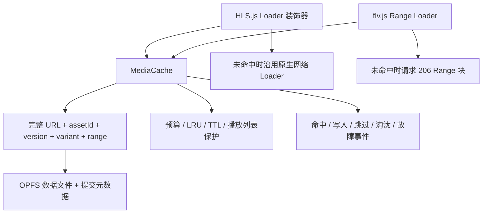

# 从大屏轮播问题到通用 OPFS 媒体缓存库

## 问题与目标

最初场景是多个大视频长期轮播。默认 HTTP 缓存的容量、单资源处理和淘汰由浏览器决定，应用无法保证下一轮仍能复用上一轮的视频。不同设备的缓存行为也可能不同。本项目将媒体缓存移到应用管理的持久化层，明确每个视频的身份、版本、保留策略和预算。

目标是减少已缓存资源的重复网络传输，并提供可观察、可清理、可恢复的媒体缓存。首屏加速和重复播放体验是可能收益，具体效果必须通过实际设备验证。

## 技术贡献的准确表述

> 面向大屏多视频轮播，基于 OPFS 构建应用可控的媒体持久化缓存层，适配 HLS.js 分片加载与 flv.js 对齐 Range 块加载，结合资源版本隔离、播放列表保护、容量预算及故障回源，降低默认 HTTP 缓存失效引发的重复传输。

这里的贡献是针对场景的系统整合与工程实现。OPFS、分片缓存和自定义 Loader 都已有公开实践；本文不以“全球首创”“无限容量”“全面优于 IndexedDB”为宣传点。

## 架构



HLS 适配以装饰模式保留原始网络 Loader，避免重写其重试、超时和请求设置。缓存默认仅覆盖完整媒体分片；不可变 VOD 清单可主动开启缓存，密钥和 LL-HLS partial segment 默认绕过。

FLV 适配以固定大小对齐字节范围，例如 1 MiB。播放器从任意偏移 seek 时复用已落盘块，只派发请求范围内的字节。每个缓存块额外保存 8 字节的总文件长度，解决文件大小恰为块大小整数倍时，重新打开后无法知道 EOF 的问题。总长度变化时停止混用旧块，并要求调用方更新版本。文件内容同长度变化依然依赖正确的版本管理。

## 存储布局与恢复

```text
OPFS/
  opfs-media-cache-v1/
    sha256(namespace)/
      pins.json
      sha256(resourceIdentity)/
        data
        entry.json
```

1. 在命名空间锁内确定容量可行性和淘汰候选。
2. 写入 `data`，等待 writable 关闭成功。
3. 写入 `entry.json` 作为提交标记，包含内容校验和、长度、身份和时间。
4. 初始化或检查列表时，清理无提交标记、元数据无效或长度不一致的目录。
5. 读取时默认重新校验 SHA-256；损坏条目视为未命中并删除，再由播放器回源。

这不是数据库级多文件原子事务。数据与元数据的提交顺序、命名空间串行化和恢复流程共同提供可恢复性；临时磁盘空间、突然断电和浏览器实现仍有边界。访问时间更新失败不会丢弃已成功读取的数据。

Web Locks 覆盖同命名空间的读写、淘汰和清理。无 Web Locks 时仅保证同一实例内部串行，不能宣称跨标签页安全。异步 HLS 写入有待写字节预算；超出时跳过缓存，不阻塞播放器继续工作。

## 为什么加入播放列表保护

单纯 LRU 在循环扫描大于容量的资源集合时，仍可能出现缓存抖动。OPFS 本身不能消除这一问题。

`setPinnedAssets()` 将当前业务播放列表的逻辑视频标为不可自动容量淘汰。新块写入前先判断候选淘汰是否足够；不足则保留现有数据，跳过新写入并产生 `pinned-budget-exceeded` 事件。调用方可据此提高预算、减少视频、切换码率或提示部分缓存。

保护名单不等于预下载任务；也不保护显式删除、TTL 到期或浏览器整站清理。它不能让超过实际可用空间的视频集合全部存下。

## 与参考方案的区别

| 方案 | 本次参考的能力 | 本项目的选择 |
| --- | --- | --- |
| Shaka Player | 分片/清单管理、下载生命周期、存储抽象 | 保持为轻量缓存层，通过现有播放器加载接口接入；不重写完整播放器、DRM 或流媒体协议栈 |
| hls-movie-player-with-cache | Service Worker + Cache Storage 的预缓存与本地优先响应 | 无需注册 Service Worker；HLS 自动边播边缓存，加上 FLV Range 缓存与播放列表保护 |
| 原始业务 Demo | 自定义 HLS Loader + OPFS 分片落盘 | 增加版本/范围/表示隔离、校验、预算、取消、恢复、类型和验证 |

OPFS 面向文件、流和按偏移读写，适合扩展媒体文件管理。IndexedDB 在事务、索引和结构化查询上有优势，Cache Storage 在请求/响应存取上有优势。三者通常共享站点配额，不存在本库通过 OPFS 获得额外独享容量的承诺。

当前采用每条目一个目录、数据文件和 JSON 元数据，便于验证与恢复；大量小文件的开销、每次扫描目录及校验成本，需要基准测量后决定是否增加索引、批量提交或 Worker 同步访问句柄。v0.1 没有启用 SyncAccessHandle，不能借用它的性能结论为本实现背书。

## 验证口径

回归测试使用内存 Store 验证策略，真实浏览器测试单独覆盖 OPFS。HLS / FLV 测试素材通过 FFmpeg 合成，不依赖外部视频。

浏览器测试给测试媒体设置 `Cache-Control: no-store`，首播后刷新页面，断网重播，确认媒体请求不再到达服务端，并检查缓存命中。另构造仅有数据文件、没有元数据的中断状态，确认新实例修复。

这只能证明已覆盖路径的正确性，不能证明跨浏览器兼容、长期高负载稳定性或优于其他存储。比较性能时应控制素材、播放器、网络、并发和内存缓存，分别测量首次写入、刷新后读取、命中字节比例、P95 延迟、内存、磁盘占用与异常恢复。

## 后续方向

- 各浏览器/不同 OPFS 接口的兼容矩阵与一致性能测试。
- 合并重复请求、受控预取与整组资源完整性清单。
- 可选的 IndexedDB 元数据索引，减少大目录扫描。
- Worker / SyncAccessHandle 后端，经过实测再决定是否启用。
- 原生 HLS / 普通 video 的可选 Service Worker 桥接。
- 对自适应码率播放单独设计“磁盘读取速度与网络带宽估计”的隔离。
- 可插拔 Cache Storage / IndexedDB 后端，用相同工作负载公开对比。

## 开源范围与来源

新实现与示例采用 MIT；未复制参考项目源码。HLS.js / flv.js 保持各自许可证，作为可选 peer dependencies。

- [Shaka Player 源码](https://github.com/shaka-project/shaka-player)
- [HLS 缓存示例源码](https://github.com/code4fukui/hls-movie-player-with-cache)
- [HLS.js Loader 接口](https://hlsjs.video-dev.org/api-docs/hls.js.loader)
- [flv.js IO Loader 与回调](https://github.com/bilibili/flv.js/blob/master/src/io/loader.js)
- [OPFS 介绍](https://web.dev/articles/origin-private-file-system)
- [站点配额与淘汰](https://developer.mozilla.org/en-US/docs/Web/API/Storage_API/Storage_quotas_and_eviction_criteria)

当前交付是本地开源就绪项目；远程 GitHub 仓库和 npm 包尚未发布。
