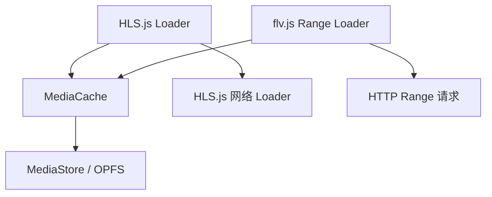

# 视频轮播的磁盘缓存设计

## 从轮播场景出发

大屏通常会长期循环播放几段视频。如果这组资源超过默认 HTTP 缓存能保留的范围，播放后面的视频时可能挤掉前面的内容，下一轮又要重新下载。

OPFS Media Cache 把这些媒体数据保存为站点私有文件。播放器请求分片时先查本地，未命中再走网络。应用通过容量预算、资源版本和播放列表保护，决定哪些内容需要留下。

## 播放器与存储分开



`MediaCache` 负责资源身份、校验、容量和淘汰策略；`MediaStore` 负责文件及元数据的读写。播放器适配层只需要知道资源是否命中，不必处理磁盘目录。

目前内置 OPFS 后端。后续增加 IndexedDB 或 Cache Storage 时，保留同一套播放器适配与缓存策略，在配置中选择存储实现。

## HLS：沿用播放器的网络加载

HLS.js 已有自己的超时、重试、请求设置和取消处理。适配器包裹原始 Loader，在它之前查一次缓存：

1. 命中时，把分片数据交给 HLS.js。
2. 未命中或本地读取超时，交回原始 Loader。
3. 网络加载成功后，加入有大小上限的后台写入队列。

默认只保存完整媒体分片。静态点播可以开启清单缓存；重定向清单保留网络加载，以免改变相对地址的解析基准。缓存命中返回绝对资源 URL，保证刷新前后的分片地址一致。

缓存计时反映磁盘读取速度，而 HLS.js 的自适应码率通常根据加载耗时估算带宽。当前先服务固定码率轮播，后续需要单独处理缓存命中对 ABR 的影响。

## FLV：按对齐字节块复用

FLV 点播按固定大小发起 Range 请求，默认每块 1 MiB。比如播放器从 1.5 MiB 处 seek，适配器读取覆盖该位置的块，只向播放器派发所需范围内的数据。

服务器返回的起止偏移、总长度和实际响应长度都需要匹配。每个缓存块附带 8 字节总文件长度，因此刷新后即使文件大小恰好为块大小的整数倍，也能确定结束位置。

直播持续产生新数据，使用网络流式加载。参数式 seek 也沿用传入的 SeekHandler。没有 Range 支持时，从头播放可以退回普通网络流；非零 seek 收到完整文件响应则报错，避免把错误的字节偏移交给播放器。

## 文件怎么保存

```text
opfs-media-cache-v1/
  sha256(namespace)/
    pins.json
    sha256(resourceIdentity)/
      data
      entry.json
```

资源身份包含完整 URL、`assetId`、`version`、`variant` 和字节范围。`assetId` 用于归组与保护，`version` 区分内容更新，`variant` 区分同一 URL 下的不同表示或用户数据。

写入时先保存 `data` 并关闭文件，再写 `entry.json`。元数据记录长度、校验和和时间，作为条目已完成的标记。初始化时清理未提交或长度异常的文件；读取时校验 SHA-256，损坏条目删除后重新加载。

文件和元数据分两次提交，恢复流程负责处理两次写入之间的中断。Web Locks 用于协调同一命名空间的读写、淘汰和清理；没有 Web Locks 时，队列只协调当前实例。

现在采用一个条目一个目录，方便定位和恢复。资源数量增多后，目录扫描与逐条更新时间可能成为开销，后续会评估元数据索引、批量提交和 Worker 文件访问。

## 为什么要保护播放列表

如果循环播放的资源集合大于缓存容量，单纯使用 LRU 仍可能不断淘汰下一轮要播的内容。

`setPinnedAssets()` 用来标记当前轮播列表。写入前先判断：淘汰未保护的条目后，是否放得下新数据。如果仍放不下，就保留现有内容，跳过这次缓存并发出事件。应用可以据此提高预算、减少视频或调整码率。

保护只影响容量淘汰。TTL 到期、手动清理和浏览器站点数据清理仍会删除文件；设置保护也不会触发预下载。

## 选用 OPFS 的考虑

视频在这里被当作文件和字节块管理，OPFS 的文件接口与这个模型比较接近，也便于后续尝试按偏移读取和写入。

IndexedDB 更擅长索引、事务和结构化数据，Cache Storage 则直接保存请求与响应。它们与 OPFS 都受浏览器站点存储配额管理。选择后端时，还需要比较具体素材下的读写耗时、内存、磁盘占用和维护成本。

下一阶段计划通过配置选择后端，明确切换时旧缓存的处理方式，并用同一套素材比较各实现。目前可通过 `store` 注入符合 `MediaStore` 接口的实例。

## 参考

- [Shaka Player](https://github.com/shaka-project/shaka-player)：分片与清单管理、下载生命周期、存储抽象。
- [hls-movie-player-with-cache](https://github.com/code4fukui/hls-movie-player-with-cache)：Service Worker 与 Cache Storage 的 HLS 缓存实现。
- [HLS.js Loader](https://hlsjs.video-dev.org/api-docs/hls.js.loader) 与 [flv.js Loader](https://github.com/bilibili/flv.js/blob/master/src/io/loader.js)：播放器接入接口。
- [OPFS](https://web.dev/articles/origin-private-file-system) 与[浏览器存储配额](https://developer.mozilla.org/en-US/docs/Web/API/Storage_API/Storage_quotas_and_eviction_criteria)。
